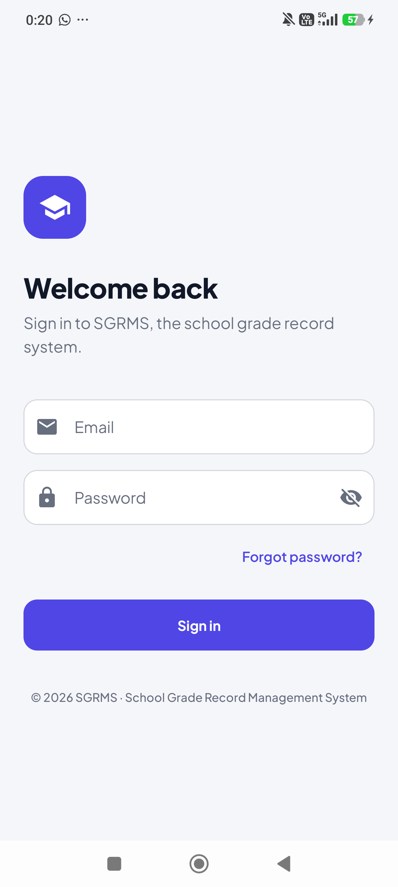
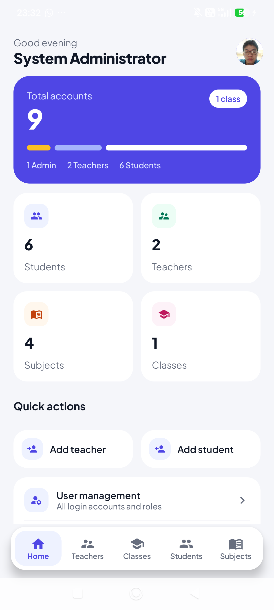
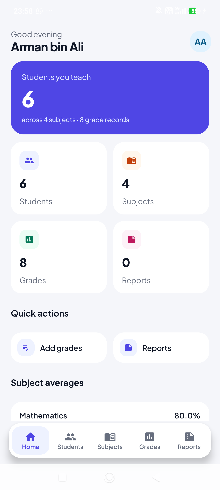
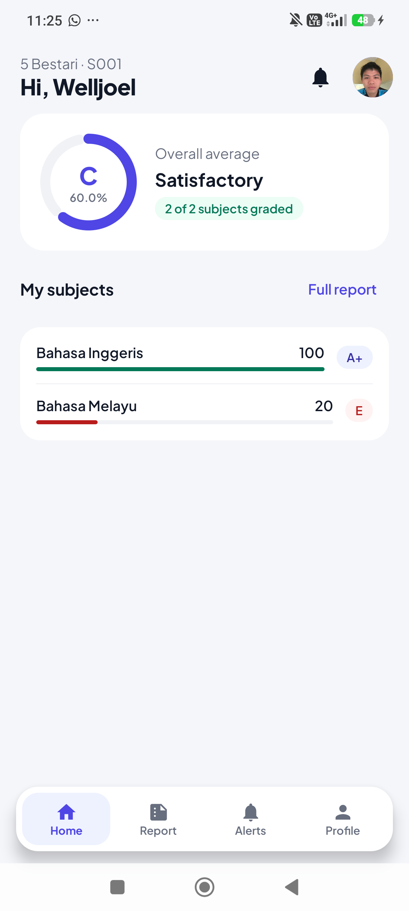
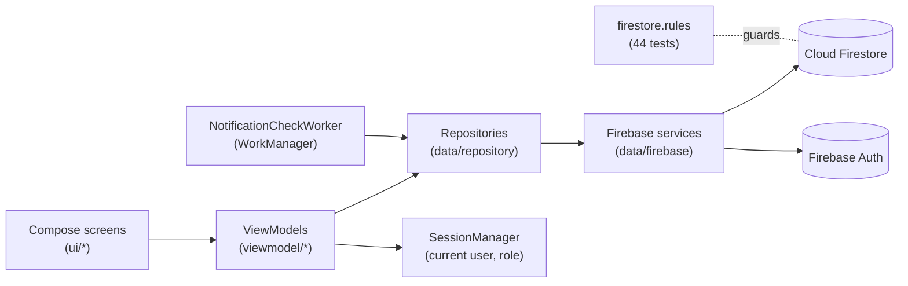

<p align="center">
  
</p>

<h1 align="center">SGRMS — Student Grade Record Management System</h1>

<p align="center">
  An Android app for schools to record grades, build report cards and keep students informed,
  with separate experiences for <b>Admins</b>, <b>Teachers</b> and <b>Students</b>.
</p>

<p align="center">
  
  
  
  
  
</p>

---

## Screenshots

| Sign in | Admin | Teacher | Student |
|:---:|:---:|:---:|:---:|
|  |  |  |  |

## Features

**Admin**
- Dashboard with account totals, a role breakdown and the newest accounts
- Create and delete teacher and student login accounts
- Manage teachers, classes, students and subjects, with search and filter chips
- Reports overview for every student

**Teacher**
- Dashboard with students taught, grade records, ready reports and per-subject averages
- Bulk grade entry for a whole class and subject; it shows the marks already saved and only saves the ones that changed
- Grade list, student details and report cards with teacher remarks
- PDF report cards saved to the phone

**Student**
- Dashboard with an overall-average ring and a mark bar per subject
- Personal report card with PDF download
- Grade notifications, both in the app and as phone notifications
- Profile with a photo and family / contact details

**Everyone**
- Email sign-in, forgot password (reset email) and change password
- Session restore on launch and role-based route guards
- A consistent "Indigo Clean" design system, with a navigation rail in landscape

## Tech stack

| Area | Choice |
|---|---|
| Language | Kotlin 2.2, coroutines |
| UI | Jetpack Compose, Material 3, Plus Jakarta Sans (downloadable font) |
| Architecture | MVVM, repositories, a single `SessionManager`, Navigation Compose |
| Dependency injection | Hilt (KSP) |
| Backend | Firebase Authentication and Cloud Firestore |
| Background work | WorkManager |
| Testing | JUnit unit tests; Firestore rules tests with `@firebase/rules-unit-testing` on the emulator |

## Architecture



- **Screens** are stateless where possible and built from shared components in `ui/components`: page header, list and detail templates, stat cards, status chips and form fields.
- **ViewModels** hold screen state as `StateFlow` and map exceptions to readable messages (`toUserMessage()`).
- **Business rules** live in plain Kotlin objects that are unit tested: `GradeCalculator`, `ReportCalculator`, `ValidationUtils`, `bulkGradeRecord`.
- **Security** is enforced server-side by `firestore.rules`, not by hiding buttons. Each role can only read and write what it should, and 44 emulator tests prove it.

### Design decisions

SGRMS is built to run entirely on Firebase's **free Spark plan**, which has no Cloud Functions:

| Need | Approach on Spark |
|---|---|
| Admin creates a login for someone else | `AccountService` signs up the new user on a **second `FirebaseApp`**, so the Admin stays signed in |
| Push notifications without a server | `NotificationCheckWorker` checks Firestore about every 15 minutes and shows new grades as phone notifications |
| Profile photos without Cloud Storage | Compressed images in a `profileImages/{uid}` Firestore document |
| Dashboard numbers without reading every document | Firestore `count()` / `average()` aggregation queries with composite indexes |

The optional Cloud Functions in [`functions/`](functions/README.md) show how the same features would work on the paid Blaze plan.

## Project structure

```
app/src/main/java/com/wilanwell/sgrms/
├── data/            # models, Firebase services, repositories, session
├── di/              # Hilt modules
├── navigation/      # routes and the NavHost with role guards
├── notifications/   # WorkManager check + notification channel
├── ui/              # screens by feature + shared components + theme
├── utils/           # grade / report rules, validation, PDF generator
└── viewmodel/       # screen state
firestore.rules      # security rules
firestore-tests/     # rules tests (Firestore emulator)
tools/               # generate_logo.py: builds every logo asset from one geometry
docs/                # screenshots, logo, design notes
```

## Getting started

**Requirements:** Android Studio (recent stable), JDK 17+, Node.js 18+ and the Firebase CLI (only for rules and indexes).

1. **Create a Firebase project** and enable **Email/Password** sign-in and **Cloud Firestore**.
2. **Register an Android app** with the package name `com.wilanwell.sgrms`, download `google-services.json` and put it in `app/`.
3. **Deploy the security rules and indexes:**
   ```bash
   firebase use --add            # pick your project
   firebase deploy --only firestore
   ```
4. **Create the first Admin.** Add a user in Firebase Authentication, then add a `users/{uid}` document with `role: "Admin"`, `fullName` and `email`. The Admin then creates teacher and student accounts from the app.
5. **Run the app** from Android Studio, or:
   ```bash
   ./gradlew :app:installDebug
   ```

## Testing

```bash
# Unit tests (grade rules, report rules, validation, contrast, dashboard helpers)
./gradlew :app:testDebugUnitTest

# Firestore security rules, on the emulator
cd firestore-tests && npm install && npm test
```

## Roadmap

- Move UI strings to `strings.xml` and add a Bahasa Melayu translation
- Release build: R8 shrinking, signing config and a real application ID
- Compose UI tests for the main flows
- Split `ReportPdfGenerator` into smaller pieces
- Dark theme

## Author

Built by **Welljoel Ali @ Walter**, [@wilanwell](https://github.com/wilanwell) on GitHub.
